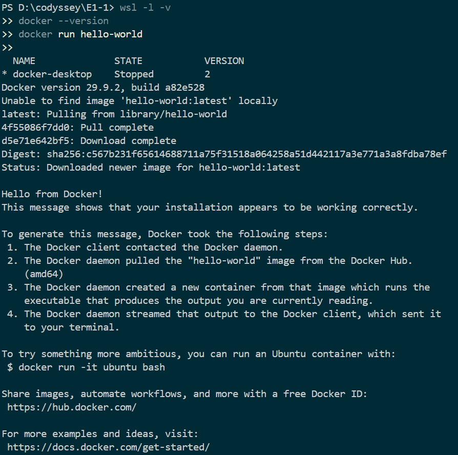
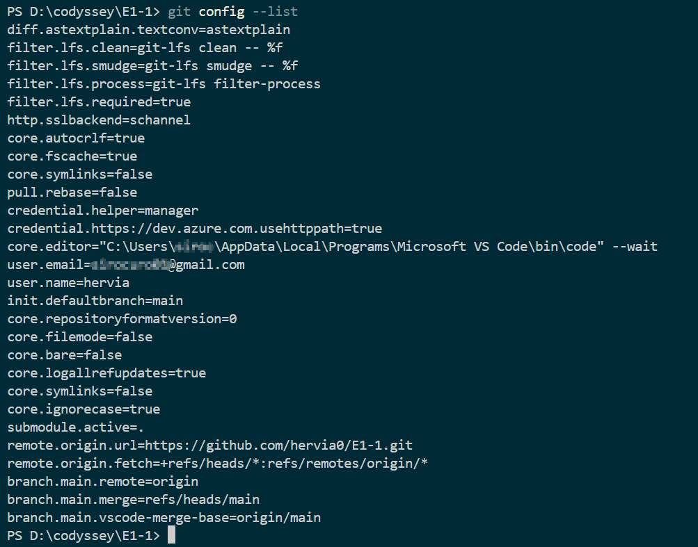
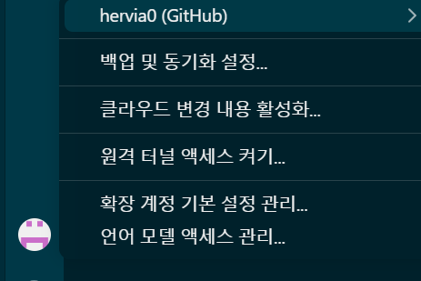
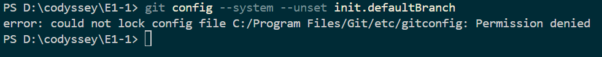
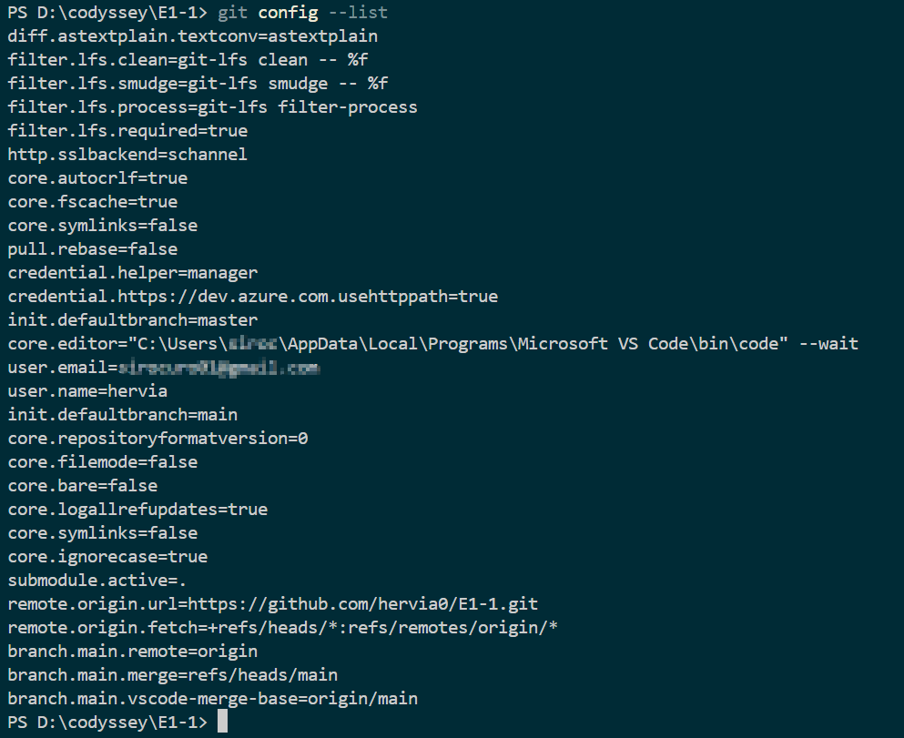
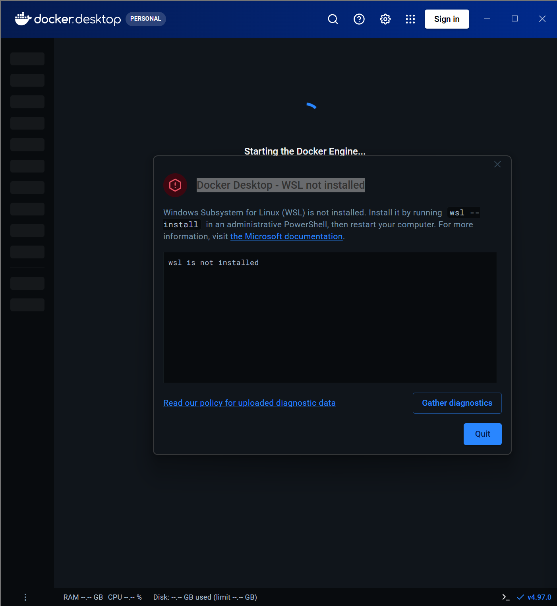

# E1-1. 개발 워크스테이션 구축

터미널, Docker, Git/GitHub를 직접 설치·설정하고, 각 단계의 수행 명령과 결과를 기록한 기술 문서입니다.

## 목차

1. [프로젝트 개요](#1-프로젝트-개요)
2. [실행 환경](#2-실행-환경)
3. [수행 항목 체크리스트](#3-수행-항목-체크리스트)
4. [터미널 조작 로그](#4-터미널-조작-로그)
5. [권한 실습](#5-권한-실습)
6. [Docker 설치 및 기본 점검](#6-docker-설치-및-기본-점검)
7. [Docker 기본 운영 명령](#7-docker-기본-운영-명령)
8. [컨테이너 실행 실습](#8-컨테이너-실행-실습)
9. [Dockerfile 기반 커스텀 이미지](#9-dockerfile-기반-커스텀-이미지)
10. [포트 매핑 및 접속 확인](#10-포트-매핑-및-접속-확인)
11. [바인드 마운트](#11-바인드-마운트)
12. [Docker 볼륨 영속성](#12-docker-볼륨-영속성)
13. [Git 설정 및 GitHub 연동](#13-git-설정-및-github-연동)
14. [트러블슈팅](#14-트러블슈팅)
15. [보안 및 개인정보 보호](#15-보안-및-개인정보-보호)

---

## 1. 프로젝트 개요

개발에 필요한 기본 워크스테이션을 구축하고, 아래 내용을 직접 수행·검증한다.

- 터미널(CLI)로 파일·디렉토리를 다루고 권한(r/w/x)을 변경한다.
- Docker를 설치하고 이미지·컨테이너를 운영한다.
- 기존 베이스 이미지로 커스텀 웹 서버 이미지를 만들고, 포트 매핑으로 접속한다.
- 바인드 마운트와 Docker 볼륨으로 데이터 반영·영속성을 확인한다.
- Git을 설정하고 GitHub·VS Code와 연동한다.

---

## 2. 실행 환경

| 항목 | 값 |
| --- | --- |
| OS | Windows 11 Home (10.0.26300) |
| 쉘 / 터미널 | Windows PowerShell 5.1 / VS Code 통합 터미널 |
| WSL | WSL 2 (`docker-desktop` 배포판) |
| Docker | Docker Desktop 4.97.0 / Docker Engine 29.9.2 |
| Git | 2.56.0.windows.2 |

```
PS D:\codyssey\E1-1> git --version
git version 2.56.0.windows.2

PS D:\codyssey\E1-1> docker --version
Docker version 29.9.2, build a82e528
```

---

## 3. 수행 항목 체크리스트

| 항목 | 상태 | 증거 위치 |
| --- | --- | --- |
| 터미널 조작 | ⬜ 진행 예정 | [4. 터미널 조작 로그](#4-터미널-조작-로그) |
| 권한 변경 (파일/디렉토리) | ⬜ 진행 예정 | [5. 권한 실습](#5-권한-실습) |
| Docker 설치 및 점검 | ✅ 완료 | [6. Docker 설치 및 기본 점검](#6-docker-설치-및-기본-점검) |
| Docker 운영 명령 | ⬜ 진행 예정 | [7. Docker 기본 운영 명령](#7-docker-기본-운영-명령) |
| hello-world / ubuntu 컨테이너 | 🔶 hello-world 완료 | [8. 컨테이너 실행 실습](#8-컨테이너-실행-실습) |
| Dockerfile 커스텀 이미지 | ⬜ 진행 예정 | [9. Dockerfile 기반 커스텀 이미지](#9-dockerfile-기반-커스텀-이미지) |
| 포트 매핑 | ⬜ 진행 예정 | [10. 포트 매핑 및 접속 확인](#10-포트-매핑-및-접속-확인) |
| 바인드 마운트 | ⬜ 진행 예정 | [11. 바인드 마운트](#11-바인드-마운트) |
| Docker 볼륨 | ⬜ 진행 예정 | [12. Docker 볼륨 영속성](#12-docker-볼륨-영속성) |
| Git 설정 | ✅ 완료 | [13. Git 설정 및 GitHub 연동](#13-git-설정-및-github-연동) |
| GitHub / VS Code 연동 | ✅ 완료 | [13. Git 설정 및 GitHub 연동](#13-git-설정-및-github-연동) |
| 트러블슈팅 2건 이상 | ✅ 완료 | [14. 트러블슈팅](#14-트러블슈팅) |

---

## 4. 터미널 조작 로그

> 진행 예정 — 현재 위치 확인, 목록 확인(숨김 파일 포함), 이동, 생성, 복사, 이동/이름변경, 삭제, 파일 내용 확인, 빈 파일 생성

```
(명령어와 출력 결과 기록 예정)
```

---

## 5. 권한 실습

> 진행 예정 — 파일 1개, 디렉토리 1개에 대해 권한 변경 전/후 비교

```
(명령어와 출력 결과 기록 예정)
```

---

## 6. Docker 설치 및 기본 점검

### 6.1 버전 확인

```
PS D:\codyssey\E1-1> docker --version
Docker version 29.9.2, build a82e528
```

### 6.2 데몬 동작 확인

`docker info` 출력에 `Server` 항목이 나타나므로 데몬이 정상 동작 중임을 확인했다. (데몬이 꺼져 있으면 `Cannot connect to the Docker daemon` 에러가 출력된다.)

```
PS D:\codyssey\E1-1> docker info
Client:
 Version:    29.9.2
 Context:    desktop-linux
 ...
Server:
 Containers: 1
  Running: 0
  Paused: 0
  Stopped: 1
 Images: 1
 Server Version: 29.9.2
 Storage Driver: overlayfs
 ...
 Kernel Version: 6.18.54.1-microsoft-standard-WSL2
 Operating System: Docker Desktop
 OSType: linux
 Architecture: x86_64
 CPUs: 12
 Total Memory: 7.343GiB
```

전체 출력: [logs/docker-info.txt](logs/docker-info.txt)

---

## 7. Docker 기본 운영 명령

> 진행 예정 — `docker images`, `docker ps`, `docker ps -a`, `docker logs`, `docker stats`

```
(명령어와 출력 결과 기록 예정)
```

---

## 8. 컨테이너 실행 실습

### 8.1 hello-world

```
PS D:\codyssey\E1-1> docker run hello-world
Unable to find image 'hello-world:latest' locally
latest: Pulling from library/hello-world
4f55086f7dd0: Pull complete
d5e71e642bf5: Download complete
Digest: sha256:c567b231f65614688711a75f31518a064258a51d442117a3e771a3a8fdba78ef
Status: Downloaded newer image for hello-world:latest

Hello from Docker!
This message shows that your installation appears to be working correctly.
...
```



### 8.2 ubuntu 컨테이너

> 진행 예정 — 컨테이너 내부 진입 후 `ls`, `echo` 실행

### 8.3 attach / exec 차이

> 진행 예정

---

## 9. Dockerfile 기반 커스텀 이미지

> 진행 예정 — 선택한 베이스 이미지, 커스텀 포인트와 목적, 빌드/실행 명령과 결과

---

## 10. 포트 매핑 및 접속 확인

> 진행 예정 — `-p <host_port>:<container_port>` 실행 후 브라우저(주소창 포함) 또는 `curl` 응답 첨부

---

## 11. 바인드 마운트

> 진행 예정 — 실행 명령, 호스트 파일 변경 전/후 비교

---

## 12. Docker 볼륨 영속성

> 진행 예정 — 볼륨 생성/연결, 컨테이너 삭제 전/후 데이터 비교

---

## 13. Git 설정 및 GitHub 연동

### 13.1 Git 사용자 정보 및 기본 브랜치 설정

```
git config --global user.name "hervia"
git config --global user.email "<이메일>"
git config --global init.defaultBranch main
git config --list
```

| 항목 | 값 |
| --- | --- |
| `user.name` | `hervia` |
| `init.defaultbranch` | `main` |
| `remote.origin.url` | `https://github.com/hervia0/E1-1.git` |



### 13.2 VS Code GitHub 로그인 및 저장소 연동

VS Code 계정 메뉴에서 `hervia0 (GitHub)` 계정으로 로그인된 것을 확인했다. 원격 저장소(`origin`)가 `hervia0/E1-1`로 연결되어 있고, 푸시까지 완료했다.



---

## 14. 트러블슈팅

### 14.1 기본 브랜치 설정이 두 개로 표시되고, 삭제 시 권한 에러 발생

| 단계 | 내용 |
| --- | --- |
| **문제** | `git config --global init.defaultBranch main` 설정 후 `git config --list`에 `init.defaultbranch=master`와 `init.defaultbranch=main`이 함께 표시됨. `master`를 지우려고 `git config --system --unset`을 실행하자 `Permission denied` 발생 |
| **원인 가설** | Git 설정은 system / global / local 단계로 나뉘며, `master`는 Git for Windows 설치 시 system 설정에 기록된 값일 것. system 설정 파일은 `C:\Program Files` 아래에 있어 관리자 권한이 필요할 것 |
| **확인** | 에러 메시지에서 대상 파일이 `C:/Program Files/Git/etc/gitconfig`(system 설정)임을 확인. 같은 키가 여러 단계에 있으면 나중에 읽는 값(global의 `main`)이 우선 적용됨 |
| **해결** | 관리자 권한 PowerShell에서 `git config --system --unset init.defaultBranch` 실행 → `git config --list`에 `main`만 남음 |

```
PS D:\codyssey\E1-1> git config --system --unset init.defaultBranch
error: could not lock config file C:/Program Files/Git/etc/gitconfig: Permission denied
```



| 변경 전 | 변경 후 |
| --- | --- |
|  |  |

### 14.2 Docker Desktop 실행 시 "WSL not installed" 에러

| 단계 | 내용 |
| --- | --- |
| **문제** | Docker Desktop 설치 중 "Virtual Machine Platform" 기능이 필요하다는 안내가 나왔고, 설치 후 실행하자 "WSL not installed" 에러로 Docker Engine이 시작되지 않음 |
| **원인 가설** | Docker Desktop은 WSL 2 위에서 동작하는데, WSL과 가상 머신 플랫폼 기능이 설치되지 않았을 것. 사용자 단위(per-user) 설치는 관리자 권한이 없어 이 기능을 켤 수 없음 |
| **확인** | `wsl --status` 실행 결과 "Linux용 Windows 하위 시스템이 설치되어 있지 않습니다" 출력 |
| **해결** | 관리자 PowerShell에서 `wsl --install` 실행 → 재부팅 → Docker Desktop 재실행 → `docker run hello-world` 성공 |

```
Docker Desktop requires the "Virtual Machine Platform" Windows feature,
which is not enabled on this machine.
A per-user installation cannot enable it, because that requires administrator privileges.
```

| 해결 전 | 해결 후 |
| --- | --- |
|  |  |

---

## 15. 보안 및 개인정보 보호

- 문서·로그·스크린샷에 토큰, 비밀번호, 개인키, 인증 코드가 포함되지 않도록 확인했다.
- GitHub 인증은 Git Credential Manager(`credential.helper=manager`)를 사용하며, 인증 정보는 저장소에 기록되지 않는다.
