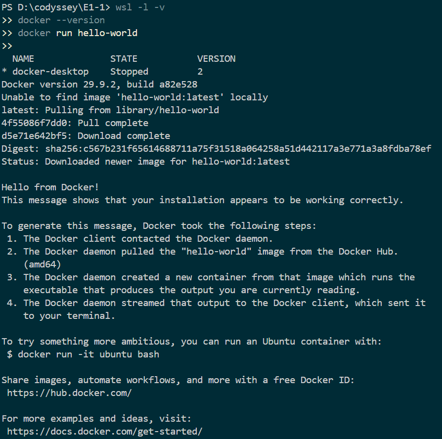
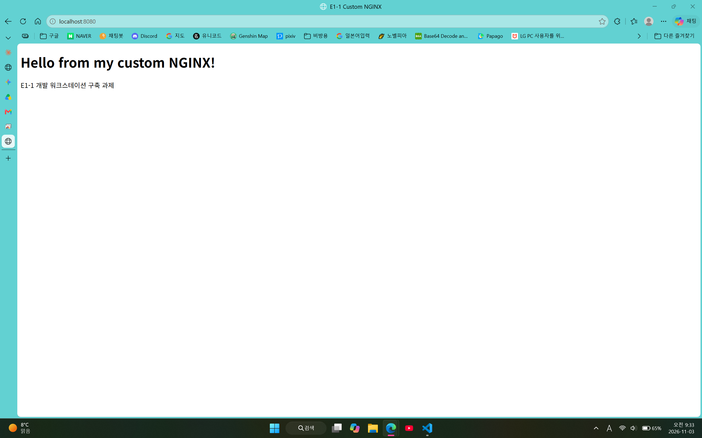
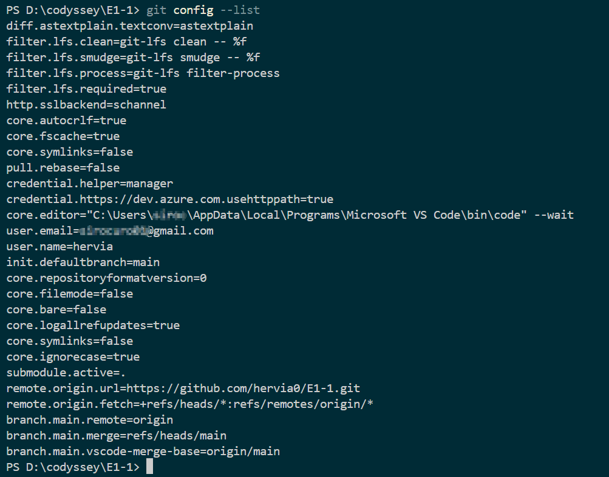
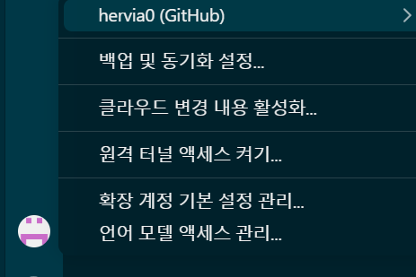
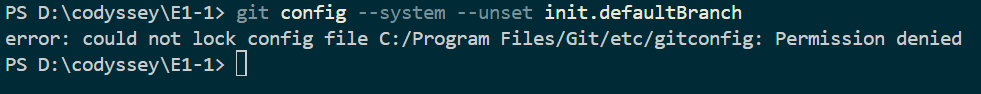
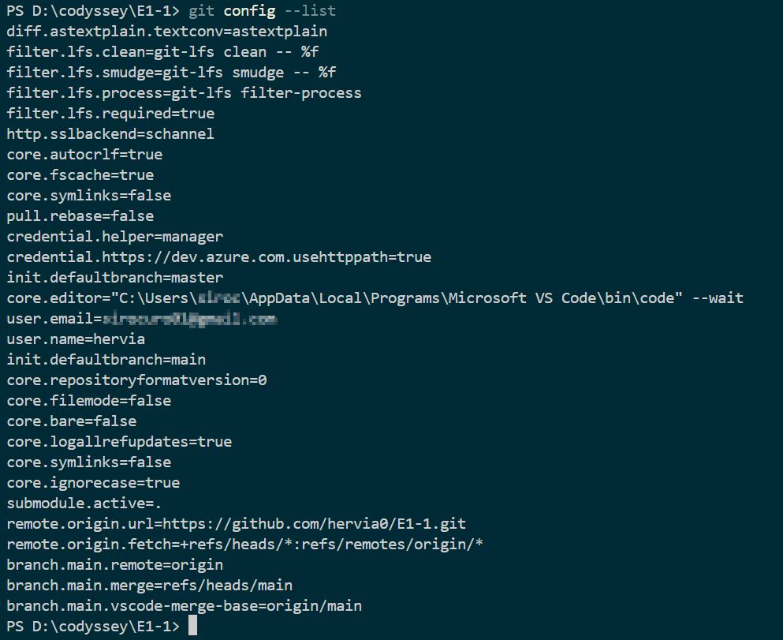
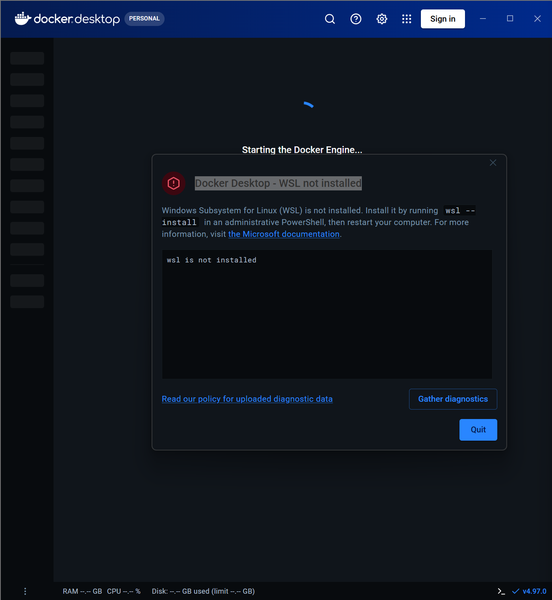

# E1-1. 개발 워크스테이션 구축

터미널, Docker, Git/GitHub를 직접 설치·설정하고, 각 단계의 수행 명령과 결과를 기록한 기술 문서입니다.

## 목차

1. [프로젝트 개요](#1-프로젝트-개요)
2. [실행 환경](#2-실행-환경)
3. [수행 항목 체크리스트](#3-수행-항목-체크리스트)
4. [터미널 조작 로그](#4-터미널-조작-로그)
5. [권한 실습](#5-권한-실습)
6. [Docker 설치 및 기본 점검](#6-docker-설치-및-기본-점검)
7. [Docker 기본 운영 명령](#7-docker-기본-운영-명령)
8. [컨테이너 실행 실습](#8-컨테이너-실행-실습)
9. [Dockerfile 기반 커스텀 이미지](#9-dockerfile-기반-커스텀-이미지)
10. [포트 매핑 및 접속 확인](#10-포트-매핑-및-접속-확인)
11. [바인드 마운트](#11-바인드-마운트)
12. [Docker 볼륨 영속성](#12-docker-볼륨-영속성)
13. [Git 설정 및 GitHub 연동](#13-git-설정-및-github-연동)
14. [트러블슈팅](#14-트러블슈팅)
15. [보안 및 개인정보 보호](#15-보안-및-개인정보-보호)
16. [보너스: Docker Compose](#16-보너스-docker-compose)

---

## 1. 프로젝트 개요

개발에 필요한 기본 워크스테이션을 구축하고, 아래 내용을 직접 수행·검증한다.

- 터미널(CLI)로 파일·디렉토리를 다루고 권한(r/w/x)을 변경한다.
- Docker를 설치하고 이미지·컨테이너를 운영한다.
- 기존 베이스 이미지로 커스텀 웹 서버 이미지를 만들고, 포트 매핑으로 접속한다.
- 바인드 마운트와 Docker 볼륨으로 데이터 반영·영속성을 확인한다.
- Git을 설정하고 GitHub·VS Code와 연동한다.

---

## 2. 실행 환경

| 항목 | 값 |
| --- | --- |
| OS | Windows 11 Home (10.0.26300) |
| 쉘 / 터미널 | Windows PowerShell 5.1 / VS Code 통합 터미널 |
| WSL | WSL 2 (`docker-desktop` 배포판) |
| Docker | Docker Desktop 4.97.0 / Docker Engine 29.9.2 |
| Git | 2.56.0.windows.2 |

```
PS D:\codyssey\E1-1> git --version
git version 2.56.0.windows.2

PS D:\codyssey\E1-1> docker --version
Docker version 29.9.2, build a82e528
```

---

## 3. 수행 항목 체크리스트

| 항목 | 상태 | 증거 위치 |
| --- | --- | --- |
| 터미널 조작 | ✅ 완료 | [4. 터미널 조작 로그](#4-터미널-조작-로그) |
| 권한 변경 (파일/디렉토리) | ✅ 완료 | [5. 권한 실습](#5-권한-실습) |
| Docker 설치 및 점검 | ✅ 완료 | [6. Docker 설치 및 기본 점검](#6-docker-설치-및-기본-점검) |
| Docker 운영 명령 | ✅ 완료 | [7. Docker 기본 운영 명령](#7-docker-기본-운영-명령) |
| hello-world / ubuntu 컨테이너 | ✅ 완료 | [8. 컨테이너 실행 실습](#8-컨테이너-실행-실습) |
| Dockerfile 커스텀 이미지 | ✅ 완료 | [9. Dockerfile 기반 커스텀 이미지](#9-dockerfile-기반-커스텀-이미지) |
| 포트 매핑 | ✅ 완료 | [10. 포트 매핑 및 접속 확인](#10-포트-매핑-및-접속-확인) |
| 바인드 마운트 | ✅ 완료 | [11. 바인드 마운트](#11-바인드-마운트) |
| Docker 볼륨 | ✅ 완료 | [12. Docker 볼륨 영속성](#12-docker-볼륨-영속성) |
| Git 설정 | ✅ 완료 | [13. Git 설정 및 GitHub 연동](#13-git-설정-및-github-연동) |
| GitHub / VS Code 연동 | ✅ 완료 | [13. Git 설정 및 GitHub 연동](#13-git-설정-및-github-연동) |
| 트러블슈팅 2건 이상 | ✅ 완료 | [14. 트러블슈팅](#14-트러블슈팅) |

---

## 4. 터미널 조작 로그

실습 환경: `ubuntu` 컨테이너 내부 (`docker run -it --name practice ubuntu bash`)

> Windows 디스크(NTFS)에서는 리눅스 권한(`chmod`)이 그대로 반영되지 않으므로, 터미널·권한 실습은 리눅스 컨테이너 안에서 수행했다.

전체 원본 로그: [logs/terminal-practice.txt](logs/terminal-practice.txt)

### 4.1 현재 위치 확인 / 목록 확인 (숨김 파일 포함)

```
root@a5eb6076e6d5:/# pwd
/
root@a5eb6076e6d5:/# ls -la
total 60
drwxr-xr-x   1 root root 4096 Nov  2 04:01 .
drwxr-xr-x   1 root root 4096 Nov  2 04:01 ..
-rwxr-xr-x   1 root root    0 Nov  2 04:01 .dockerenv
drwxr-xr-x   2 root root 4096 Oct 25 10:26 .rock
lrwxrwxrwx   1 root root    7 Apr 20  2026 bin -> usr/bin
...
drwx------   2 root root 4096 Oct 25 10:26 root
...
drwxrwxrwt   2 root root 4096 Oct 25 10:25 tmp
drwxr-xr-x  12 root root 4096 Oct 25 10:24 usr
drwxr-xr-x  11 root root 4096 Oct 25 10:26 var
```

- `-a` 옵션으로 `.`으로 시작하는 숨김 파일(`.dockerenv`, `.rock`)까지 표시된다.
- `/root`는 `drwx------`(700)로 소유자만 접근 가능하고, `/tmp`는 `drwxrwxrwt`(1777)로 누구나 쓸 수 있지만 스티키 비트(`t`) 때문에 자기 파일만 삭제할 수 있다.

### 4.2 이동 / 디렉토리 생성

```
root@a5eb6076e6d5:/# cd ~
root@a5eb6076e6d5:~# pwd
/root
root@a5eb6076e6d5:~# mkdir practice
root@a5eb6076e6d5:~# cd practice
```

### 4.3 파일 생성 (내용 있는 파일 / 빈 파일) 및 내용 확인

```
root@a5eb6076e6d5:~/practice# echo "hello" > a.txt
root@a5eb6076e6d5:~/practice# touch empty.txt
root@a5eb6076e6d5:~/practice# ls -la
total 12
drwxr-xr-x 2 root root 4096 Nov  2 05:09 .
drwx------ 1 root root 4096 Nov  2 05:09 ..
-rw-r--r-- 1 root root    6 Nov  2 05:09 a.txt
-rw-r--r-- 1 root root    0 Nov  2 05:09 empty.txt
root@a5eb6076e6d5:~/practice# cat a.txt
hello
```

- `a.txt`는 `hello` + 줄바꿈으로 6바이트, `touch`로 만든 `empty.txt`는 0바이트다.

### 4.4 복사 / 이름 변경 / 이동

```
root@a5eb6076e6d5:~/practice# cp a.txt b.txt
root@a5eb6076e6d5:~/practice# mv b.txt c.txt
root@a5eb6076e6d5:~/practice# mkdir sub
root@a5eb6076e6d5:~/practice# mv c.txt sub/
root@a5eb6076e6d5:~/practice# ls -la sub
total 12
drwxr-xr-x 2 root root 4096 Nov  2 05:10 .
drwxr-xr-x 3 root root 4096 Nov  2 05:10 ..
-rw-r--r-- 1 root root    6 Nov  2 05:10 c.txt
```

- `mv`는 같은 디렉토리 안에서는 **이름 변경**(`b.txt` → `c.txt`), 다른 디렉토리로 지정하면 **이동**(`c.txt` → `sub/`)으로 동작한다.

### 4.5 삭제

```
root@a5eb6076e6d5:~/practice# rm sub/c.txt
root@a5eb6076e6d5:~/practice# rmdir sub
root@a5eb6076e6d5:~/practice# ls -la
total 12
drwxr-xr-x 2 root root 4096 Nov  2 05:11 .
drwx------ 1 root root 4096 Nov  2 05:09 ..
-rw-r--r-- 1 root root    6 Nov  2 05:09 a.txt
-rw-r--r-- 1 root root    0 Nov  2 05:09 empty.txt
```

- `rmdir`은 빈 디렉토리만 삭제할 수 있으므로, 안의 파일을 먼저 `rm`으로 지웠다.

### 4.6 절대 경로 / 상대 경로 이동

```
root@a5eb6076e6d5:~/practice# cd /tmp
root@a5eb6076e6d5:/tmp# pwd
/tmp
root@a5eb6076e6d5:/tmp# cd -
/root/practice
```

- `cd /tmp`는 루트(`/`)부터 시작하는 **절대 경로**, `cd practice`·`cd sub`처럼 현재 위치 기준으로 쓰는 것은 **상대 경로**다.
- `cd -`는 직전 디렉토리(`/root/practice`)로 돌아간다.

---

## 5. 권한 실습

실습 환경: `ubuntu` 컨테이너 내부 `/root/practice` (4장과 같은 컨테이너)

### 5.1 변경 전

```
root@a5eb6076e6d5:~/practice# mkdir perm-dir
root@a5eb6076e6d5:~/practice# ls -l a.txt
-rw-r--r-- 1 root root 6 Nov  2 05:09 a.txt
root@a5eb6076e6d5:~/practice# ls -ld perm-dir
drwxr-xr-x 2 root root 4096 Nov  2 05:11 perm-dir
```

- 디렉토리 자체의 권한을 보려면 `ls -ld`를 쓴다. (`-d`가 없으면 디렉토리 안의 목록이 출력된다.)

### 5.2 권한 변경

```
root@a5eb6076e6d5:~/practice# chmod 755 a.txt
root@a5eb6076e6d5:~/practice# chmod 700 perm-dir
```

### 5.3 변경 후

```
root@a5eb6076e6d5:~/practice# ls -l a.txt
-rwxr-xr-x 1 root root 6 Nov  2 05:09 a.txt
root@a5eb6076e6d5:~/practice# ls -ld perm-dir
drwx------ 2 root root 4096 Nov  2 05:11 perm-dir
```

### 5.4 전/후 비교

| 대상 | 변경 전 | 명령 | 변경 후 | 의미 |
| --- | --- | --- | --- | --- |
| `a.txt` (파일) | `-rw-r--r--` (644) | `chmod 755` | `-rwxr-xr-x` (755) | 모든 사용자에게 실행(x) 권한 추가 |
| `perm-dir` (디렉토리) | `drwxr-xr-x` (755) | `chmod 700` | `drwx------` (700) | 그룹·기타 사용자의 접근을 모두 차단, 소유자만 사용 |

### 5.5 숫자 표기 해석 규칙

- 세 자리는 순서대로 **소유자(user) / 그룹(group) / 기타(others)** 의 권한이다.
- 각 자리는 **r=4, w=2, x=1** 을 더한 값이다.

| 숫자 | 계산 | 기호 |
| --- | --- | --- |
| 7 | 4 + 2 + 1 | `rwx` |
| 6 | 4 + 2 | `rw-` |
| 5 | 4 + 1 | `r-x` |
| 4 | 4 | `r--` |
| 0 | — | `---` |

- `755` = `rwx` / `r-x` / `r-x`, `644` = `rw-` / `r--` / `r--`, `700` = `rwx` / `---` / `---`
- 디렉토리의 `x`는 **안으로 들어가거나(`cd`) 내부 파일에 접근할 수 있는 권한**이므로, `700`인 `perm-dir`에는 소유자 외에는 들어갈 수 없다.

> 참고: 컨테이너 안의 사용자는 `root`이므로 권한 설정과 상관없이 대부분의 파일에 접근할 수 있다. 위 실습은 권한 값이 바뀌는 것을 `ls -l`로 확인한 것이다.

---

## 6. Docker 설치 및 기본 점검

### 6.1 버전 확인

```
PS D:\codyssey\E1-1> docker --version
Docker version 29.9.2, build a82e528
```

### 6.2 데몬 동작 확인

`docker info` 출력에 `Server` 항목이 나타나므로 데몬이 정상 동작 중임을 확인했다. (데몬이 꺼져 있으면 `Cannot connect to the Docker daemon` 에러가 출력된다.)

```
PS D:\codyssey\E1-1> docker info
Client:
 Version:    29.9.2
 Context:    desktop-linux
 ...
Server:
 Containers: 1
  Running: 0
  Paused: 0
  Stopped: 1
 Images: 1
 Server Version: 29.9.2
 Storage Driver: overlayfs
 ...
 Kernel Version: 6.18.54.1-microsoft-standard-WSL2
 Operating System: Docker Desktop
 OSType: linux
 Architecture: x86_64
 CPUs: 12
 Total Memory: 7.343GiB
```

전체 출력: [logs/docker-info.txt](logs/docker-info.txt)

---

## 7. Docker 기본 운영 명령

### 7.1 이미지 다운로드 / 목록 확인

이미지 다운로드(`pull`)는 `docker run` 시 로컬에 이미지가 없으면 자동으로 수행된다. ([8.2](#82-ubuntu-컨테이너)의 `ubuntu` 다운로드 로그 참고)

```
PS D:\codyssey\E1-1> docker images
IMAGE                ID             DISK USAGE   CONTENT SIZE   EXTRA
hello-world:latest   c567b231f656       25.9kB         9.49kB    U
my-web:1.0           59f5a3be7c04       93.6MB         26.3MB
ubuntu:latest        6a06111c3b0a        163MB         45.9MB    U
```

- `EXTRA`의 `U`(In Use)는 해당 이미지로 만든 컨테이너가 존재한다는 뜻이다.

### 7.2 컨테이너 실행 / 중지 / 목록 확인

```
PS D:\codyssey\E1-1> docker start practice
practice
PS D:\codyssey\E1-1> docker ps
CONTAINER ID   IMAGE     COMMAND   CREATED        STATUS         PORTS     NAMES
a5eb6076e6d5   ubuntu    "bash"    20 hours ago   Up 8 seconds             practice

PS D:\codyssey\E1-1> docker ps -a
CONTAINER ID   IMAGE         COMMAND    CREATED        STATUS                     PORTS     NAMES
a5eb6076e6d5   ubuntu        "bash"     20 hours ago   Exited (0) 8 seconds ago             practice
f29dc136fde3   hello-world   "/hello"   2 days ago     Exited (0) 2 days ago                stupefied_snyder
```

- `docker ps`는 **실행 중**인 컨테이너만, `docker ps -a`는 **종료된 컨테이너까지** 모두 보여준다.
- 실행·중지 과정 전체는 [8.2](#82-ubuntu-컨테이너), [8.3](#83-attach--exec-차이)에 기록했다.

### 7.3 로그 확인

```
PS D:\codyssey\E1-1> docker logs my-web
/docker-entrypoint.sh: Configuration complete; ready for start up
2026/11/03 00:30:47 [notice] 1#1: nginx/1.31.8
2026/11/03 00:30:47 [notice] 1#1: start worker processes
...
::1 - - [03/Nov/2026:00:31:17 +0000] "GET / HTTP/1.1" 200 235 "-" "Wget" "-"
172.17.0.1 - - [03/Nov/2026:00:31:38 +0000] "GET / HTTP/1.1" 200 235 "-" "curl/8.21.0" "-"
::1 - - [03/Nov/2026:00:31:47 +0000] "GET / HTTP/1.1" 200 235 "-" "Wget" "-"
172.17.0.1 - - [03/Nov/2026:00:32:55 +0000] "GET / HTTP/1.1" 200 235 "-" "Mozilla/5.0 (Windows NT 10.0; Win64; x64) ... Edg/156.0.0.0" "-"
2026/11/03 00:32:55 [error] 31#31: *7 open() "/usr/share/nginx/html/favicon.ico" failed (2: No such file or directory), ...
172.17.0.1 - - [03/Nov/2026:00:32:55 +0000] "GET /favicon.ico HTTP/1.1" 404 555 ...
::1 - - [03/Nov/2026:00:33:17 +0000] "GET / HTTP/1.1" 200 235 "-" "Wget" "-"
```

전체 로그: [logs/docker-logs-my-web.txt](logs/docker-logs-my-web.txt)

| 요청 출처 | User-Agent | 의미 |
| --- | --- | --- |
| `::1` (컨테이너 자신) | `Wget` | Dockerfile의 `HEALTHCHECK`가 **30초마다** 보내는 요청 |
| `172.17.0.1` | `curl/8.21.0` | 호스트에서 `curl.exe`로 보낸 요청 |
| `172.17.0.1` | `Mozilla/5.0 ... Edg/156` | 호스트 브라우저(Edge) 접속 |

- 호스트의 요청이 `172.17.0.1`(Docker 기본 브리지 네트워크의 게이트웨이)에서 들어온 것으로 기록되어, 포트 매핑을 거쳐 컨테이너로 전달되었음을 확인할 수 있다.
- `favicon.ico` 404는 브라우저가 탭 아이콘을 자동으로 요청한 것으로, 해당 파일을 만들지 않았기 때문에 발생한 정상적인 결과다.

### 7.4 리소스 확인

```
PS D:\codyssey\E1-1> docker stats --no-stream
CONTAINER ID   NAME      CPU %     MEM USAGE / LIMIT     MEM %     NET I/O           BLOCK I/O         PIDS
e8b8f49fe6df   my-web    0.00%     13.15MiB / 7.343GiB   0.17%     5.57kB / 4.32kB   1.54MB / 12.3kB   13
```

- `--no-stream`은 실시간 갱신 없이 현재 값을 한 번만 출력한다.
- NGINX 컨테이너는 메모리 약 13MiB, 프로세스 13개(마스터 1 + 워커 12)로 동작 중이다. 워커 수는 CPU 코어 수(12)에 맞춰 자동 설정되었다.

---

## 8. 컨테이너 실행 실습

### 8.1 hello-world

```
PS D:\codyssey\E1-1> docker run hello-world
Unable to find image 'hello-world:latest' locally
latest: Pulling from library/hello-world
4f55086f7dd0: Pull complete
d5e71e642bf5: Download complete
Digest: sha256:c567b231f65614688711a75f31518a064258a51d442117a3e771a3a8fdba78ef
Status: Downloaded newer image for hello-world:latest

Hello from Docker!
This message shows that your installation appears to be working correctly.
...
```



### 8.2 ubuntu 컨테이너

**이미지 다운로드 및 컨테이너 진입**

```
PS D:\codyssey\E1-1> docker run -it --name practice ubuntu bash
Unable to find image 'ubuntu:latest' locally
latest: Pulling from library/ubuntu
f3f25b84a7d7: Pull complete
edafa32f5d9e: Pull complete
21594acc2d8b: Download complete
Digest: sha256:6a06111c3b0a8600feadb270aec771dc239bf407b25625f93f44ab00e11f4d3c
Status: Downloaded newer image for ubuntu:latest
root@a5eb6076e6d5:/#
```

- 로컬에 `ubuntu` 이미지가 없어 Docker Hub에서 자동으로 받은 뒤 컨테이너를 실행했다.
- `-it`로 터미널을 연결해 프롬프트가 `root@<컨테이너ID>`로 바뀌었다.

**컨테이너 내부 명령 실행**

```
root@a5eb6076e6d5:~/practice# ls /
bin  boot  dev  etc  home  lib  lib64  media  mnt  opt  proc  root  run  sbin  srv  sys  tmp  usr  var
root@a5eb6076e6d5:~/practice# echo "hello from container"
hello from container
root@a5eb6076e6d5:~/practice# exit
exit
```

**종료 후 상태 확인**

```
PS D:\codyssey\E1-1> docker ps
CONTAINER ID   IMAGE     COMMAND   CREATED   STATUS    PORTS     NAMES
PS D:\codyssey\E1-1> docker ps -a
CONTAINER ID   IMAGE         COMMAND    CREATED             STATUS                     PORTS     NAMES
a5eb6076e6d5   ubuntu        "bash"     About an hour ago   Exited (0) 9 seconds ago             practice
f29dc136fde3   hello-world   "/hello"   46 hours ago        Exited (0) 46 hours ago              stupefied_snyder
```

- 컨테이너의 메인 프로세스(`bash`)에서 `exit`하자 컨테이너도 함께 종료되었다.
- `docker ps`는 실행 중인 컨테이너만 보여주므로 비어 있고, `docker ps -a`에는 `Exited (0)`(정상 종료) 상태로 남아 있다.
- 컨테이너는 종료되어도 삭제되지 않으므로, `docker start`로 다시 실행하거나 `docker rm`으로 지워야 한다.

### 8.3 attach / exec 차이

**1) 종료된 컨테이너 다시 시작**

```
PS D:\codyssey\E1-1> docker start practice
practice
PS D:\codyssey\E1-1> docker ps
CONTAINER ID   IMAGE     COMMAND   CREATED        STATUS         PORTS     NAMES
a5eb6076e6d5   ubuntu    "bash"    20 hours ago   Up 8 seconds             practice
```

**2) exec로 진입 후 종료 → 컨테이너는 계속 실행**

```
PS D:\codyssey\E1-1> docker exec -it practice bash
root@a5eb6076e6d5:/# echo "exec shell"
exec shell
root@a5eb6076e6d5:/# exit
exit
PS D:\codyssey\E1-1> docker ps
CONTAINER ID   IMAGE     COMMAND   CREATED        STATUS              PORTS     NAMES
a5eb6076e6d5   ubuntu    "bash"    20 hours ago   Up About a minute             practice
```

**3) attach로 진입 후 종료 → 컨테이너도 종료**

```
PS D:\codyssey\E1-1> docker attach practice
root@a5eb6076e6d5:/# echo "attach shell"
attach shell
root@a5eb6076e6d5:/# exit
exit
PS D:\codyssey\E1-1> docker ps
CONTAINER ID   IMAGE     COMMAND   CREATED   STATUS    PORTS     NAMES
PS D:\codyssey\E1-1> docker ps -a
CONTAINER ID   IMAGE         COMMAND    CREATED        STATUS                     PORTS     NAMES
a5eb6076e6d5   ubuntu        "bash"     20 hours ago   Exited (0) 8 seconds ago             practice
f29dc136fde3   hello-world   "/hello"   2 days ago     Exited (0) 2 days ago                stupefied_snyder
```

**관찰 정리**

| | `docker exec -it practice bash` | `docker attach practice` |
| --- | --- | --- |
| 연결 대상 | 컨테이너 안에 **새 bash 프로세스**를 추가로 실행 | 컨테이너의 **메인 프로세스**(`docker run` 때 지정한 `bash`)에 연결 |
| `exit` 시 | 추가로 띄운 셸만 종료 | 메인 프로세스가 종료 |
| 컨테이너 상태 | `Up` 유지 | `Exited (0)` |
| 용도 | 실행 중인 서비스 내부 확인·디버깅 | 메인 프로세스의 입출력을 직접 확인 |

- 컨테이너는 **메인 프로세스가 살아 있는 동안만 실행**된다. 따라서 운영 중인 컨테이너에 들어갈 때는 `exec`를 써야 서비스가 멈추지 않는다.
- `attach` 상태에서 컨테이너를 종료하지 않고 빠져나오려면 `exit` 대신 `Ctrl+P` → `Ctrl+Q`를 누른다.

---

## 9. Dockerfile 기반 커스텀 이미지

### 9.1 선택한 방식과 베이스

- **방식 (A)**: 웹 서버 베이스 이미지 + 정적 콘텐츠 교체
- **베이스 이미지**: [`nginx:alpine`](https://hub.docker.com/_/nginx) — Docker 공식 NGINX 이미지의 Alpine Linux 기반 경량 버전

### 9.2 파일 구조

```
E1-1/
├── app/
│   └── index.html    # 교체할 정적 페이지
└── Dockerfile
```

### 9.3 Dockerfile

```dockerfile
# 기존 베이스: 공식 NGINX 경량 이미지
FROM nginx:alpine

# 커스텀 1: 작성자 정보
LABEL maintainer="hervia"

# 커스텀 2: 기본 페이지를 내 정적 콘텐츠로 교체
COPY app/ /usr/share/nginx/html/

# 커스텀 3: 사용하는 포트 문서화
EXPOSE 80

# 커스텀 4: 헬스체크 (웹 서버 응답 확인)
HEALTHCHECK --interval=30s --timeout=3s CMD wget -q -O /dev/null http://localhost/ || exit 1
```

### 9.4 커스텀 포인트와 목적

| # | 명령 | 목적 |
| --- | --- | --- |
| 1 | `LABEL maintainer=...` | 이미지 작성자 메타데이터 기록 (`docker inspect`로 확인 가능) |
| 2 | `COPY app/ /usr/share/nginx/html/` | NGINX 기본 환영 페이지를 직접 만든 정적 페이지로 교체 |
| 3 | `EXPOSE 80` | 컨테이너가 80번 포트를 사용한다는 것을 문서화 (실제 외부 공개는 `-p`로 지정) |
| 4 | `HEALTHCHECK` | 30초마다 웹 서버 응답을 확인해 `docker ps`에 `healthy`/`unhealthy` 상태 표시 |

### 9.5 빌드

```
PS D:\codyssey\E1-1> docker build -t my-web:1.0 .
[+] Building 12.1s (7/7) FINISHED                                    docker:desktop-linux
 => [internal] load build definition from Dockerfile                                0.1s
 => => transferring dockerfile: 485B                                                0.0s
 => [internal] load metadata for docker.io/library/nginx:alpine                     3.9s
 => [internal] load .dockerignore                                                   0.1s
 => [internal] load build context                                                   0.1s
 => => transferring context: 305B                                                   0.0s
 => [1/2] FROM docker.io/library/nginx:alpine@sha256:785835ea65db...                5.3s
 => [2/2] COPY app/ /usr/share/nginx/html/                                          0.2s
 => exporting to image                                                              2.1s
 => => naming to docker.io/library/my-web:1.0                                       0.0s
```

- 빌드 단계는 `FROM`과 `COPY` 두 개만 표시된다. `LABEL`, `EXPOSE`, `HEALTHCHECK`는 파일을 바꾸지 않고 이미지 **메타데이터**만 추가하기 때문이다.
- 마지막 `.`은 **빌드 컨텍스트**(Dockerfile과 `COPY`할 파일이 있는 폴더)로, 생략하면 `requires 1 argument` 에러가 난다.

```
PS D:\codyssey\E1-1> docker images
IMAGE                ID             DISK USAGE   CONTENT SIZE   EXTRA
hello-world:latest   c567b231f656       25.9kB         9.49kB    U
my-web:1.0           59f5a3be7c04       93.6MB         26.3MB
ubuntu:latest        6a06111c3b0a        163MB         45.9MB    U
```

### 9.6 실행

```
PS D:\codyssey\E1-1> docker run -d --name my-web -p 8080:80 my-web:1.0
e8b8f49fe6df33f923e6c41c04ab6e79e8ca707a595cf5690213295357a43e4a

PS D:\codyssey\E1-1> docker ps
CONTAINER ID   IMAGE        COMMAND                   CREATED          STATUS                             PORTS                                     NAMES
e8b8f49fe6df   my-web:1.0   "/docker-entrypoint.…"   13 seconds ago   Up 12 seconds (health: starting)   0.0.0.0:8080->80/tcp, [::]:8080->80/tcp   my-web
```

- 실행 직후 `health: starting`이었다가, 첫 헬스체크가 성공한 뒤 `(healthy)`로 바뀌었다.

```
my-web  Up 50 seconds (healthy)  0.0.0.0:8080->80/tcp, [::]:8080->80/tcp
```

---

## 10. 포트 매핑 및 접속 확인

### 10.1 포트 매핑 설정

```
docker run -d --name my-web -p 8080:80 my-web:1.0
```

| 구분 | 포트 | 설명 |
| --- | --- | --- |
| 호스트 (내 PC) | `8080` | 브라우저·curl이 접속하는 포트 |
| 컨테이너 | `80` | NGINX가 내부에서 대기하는 포트 (`EXPOSE 80`) |

- 컨테이너는 호스트와 분리된 자체 네트워크를 가지므로, 컨테이너 안의 80번 포트에는 호스트에서 바로 접근할 수 없다.
- `-p 8080:80`으로 **호스트 8080 → 컨테이너 80** 전달 규칙을 만들어야 외부에서 접속할 수 있다.
- `docker ps`의 `PORTS` 열에 `0.0.0.0:8080->80/tcp`로 매핑이 표시된다.

### 10.2 curl 응답

```
PS D:\codyssey\E1-1> curl.exe http://localhost:8080
<!DOCTYPE html>
<html lang="ko">
<head>
  <meta charset="UTF-8">
  <title>E1-1 Custom NGINX</title>
</head>
<body>
  <h1>Hello from my custom NGINX!</h1>
  <p>E1-1 개발 워크스테이션 구축 과제</p>
</body>
</html>
```

- `app/index.html`에 작성한 내용이 그대로 응답되어, 커스텀 이미지의 정적 콘텐츠 교체와 포트 매핑이 모두 동작함을 확인했다.
- PowerShell에서 `curl`은 `Invoke-WebRequest`의 별칭이므로 `curl.exe`로 실행했다.

### 10.3 브라우저 접속 화면

주소창의 `localhost:8080`과 `app/index.html`의 내용이 함께 보인다.



---

## 11. 바인드 마운트

호스트의 `bind-test/` 폴더를 NGINX 컨테이너의 웹 루트에 연결하고, 호스트에서 파일을 수정했을 때 **컨테이너를 재시작하지 않아도 바로 반영되는지** 확인했다.

### 11.1 실습 파일 준비

```
PS D:\codyssey\E1-1> mkdir bind-test
PS D:\codyssey\E1-1> "<h1>Before:bind mount test<h1>" | Out-File -Encoding utf8 bind-test/index.html
PS D:\codyssey\E1-1> Get-Content bind-test/index.html
<h1>Before:bind mount test<h1>
```

### 11.2 바인드 마운트로 컨테이너 실행

```
PS D:\codyssey\E1-1> docker run -d --name my-web-bind -p 8081:80 -v "${PWD}/bind-test:/usr/share/nginx/html" nginx:alpine
e10770b527072c70444482bbf34dd1230875396208b3a2d3e538af2e71d91c88

PS D:\codyssey\E1-1> docker ps
CONTAINER ID   IMAGE          COMMAND                   CREATED         STATUS         PORTS                                     NAMES
e10770b52707   nginx:alpine   "/docker-entrypoint.…"   9 seconds ago   Up 8 seconds   0.0.0.0:8081->80/tcp, [::]:8081->80/tcp   my-web-bind
```

- `-v 호스트경로:컨테이너경로` 형식으로, 호스트의 `D:\codyssey\E1-1\bind-test`를 컨테이너의 `/usr/share/nginx/html`에 연결했다.
- PowerShell에서는 현재 폴더를 `${PWD}`로 표기한다. (Bash에서는 `$(pwd)`)

```
PS D:\codyssey\E1-1> docker inspect my-web-bind --format "{{json .Mounts}}"
[{"Type":"bind","Source":"D:\\codyssey\\E1-1/bind-test","Destination":"/usr/share/nginx/html","Mode":"","RW":true,"Propagation":"rprivate"}]
```

- `Type`이 `bind`이고, `Source`(호스트)와 `Destination`(컨테이너)이 연결되어 있다. `RW: true`로 양방향 읽기·쓰기가 가능하다.

### 11.3 변경 전

```
PS D:\codyssey\E1-1> curl.exe http://localhost:8081
<h1>Before:bind mount test<h1>
PS D:\codyssey\E1-1> docker exec my-web-bind cat /usr/share/nginx/html/index.html
<h1>Before:bind mount test<h1>
```

### 11.4 호스트에서 파일 수정

```
PS D:\codyssey\E1-1> "<h1>After: changed on host!</h1>" | Out-File -Encoding utf8 bind-test/index.html
```

### 11.5 변경 후 (컨테이너 재시작 없음)

```
PS D:\codyssey\E1-1> curl.exe http://localhost:8081
<h1>After: changed on host!</h1>
PS D:\codyssey\E1-1> docker exec my-web-bind cat /usr/share/nginx/html/index.html
<h1>After: changed on host!</h1>
```

### 11.6 반대 방향: 컨테이너 → 호스트

```
PS D:\codyssey\E1-1> docker exec my-web-bind sh -c "echo 'created in container' > /usr/share/nginx/html/from-container.txt"
PS D:\codyssey\E1-1> Get-ChildItem bind-test

    디렉터리: D:\codyssey\E1-1\bind-test

Mode                 LastWriteTime         Length Name
----                 -------------         ------ ----
-a----      2026-11-05   오후 6:57             21 from-container.txt
-a----      2026-11-05   오후 6:55             37 index.html

PS D:\codyssey\E1-1> Get-Content bind-test/from-container.txt
created in container
```

### 11.7 비교 정리

| 시점 | 호스트 `bind-test/index.html` | 컨테이너 응답 (`curl`) |
| --- | --- | --- |
| 변경 전 | `Before:bind mount test` | `Before:bind mount test` |
| 호스트에서 수정 후 | `After: changed on host!` | `After: changed on host!` (재시작 없이 즉시 반영) |

- 바인드 마운트는 파일을 **복사하는 것이 아니라 같은 폴더를 공유**하므로, 호스트와 컨테이너 어느 쪽에서 바꿔도 반대쪽에 바로 보인다.
- 반면 9장의 커스텀 이미지는 빌드 시점에 `COPY`로 파일을 이미지에 넣었으므로, `app/index.html`을 수정하면 **다시 빌드해야** 반영된다.
- 이 특성 때문에 바인드 마운트는 **개발 중 코드를 실시간으로 반영**할 때 주로 사용한다.

---

## 12. Docker 볼륨 영속성

Docker 볼륨에 데이터를 저장한 뒤 컨테이너를 **완전히 삭제**하고, 새 컨테이너에 같은 볼륨을 연결해 데이터가 남아 있는지 확인했다.

### 12.1 볼륨 생성

```
PS D:\codyssey\E1-1> docker volume create mydata
mydata
PS D:\codyssey\E1-1> docker volume ls
DRIVER    VOLUME NAME
local     mydata
PS D:\codyssey\E1-1> docker volume inspect mydata
[
    {
        "CreatedAt": "2026-11-05T10:00:10Z",
        "Driver": "local",
        "Labels": null,
        "Mountpoint": "/var/lib/docker/volumes/mydata/_data",
        "Name": "mydata",
        "Options": null,
        "Scope": "local"
    }
]
```

- 볼륨 데이터는 Docker가 관리하는 영역(`/var/lib/docker/volumes/mydata/_data`)에 저장된다. 바인드 마운트처럼 내가 경로를 지정하지 않는다.

### 12.2 볼륨 연결 및 데이터 쓰기

```
PS D:\codyssey\E1-1> docker run -d --name vol-test -v mydata:/data ubuntu sleep infinity
858d8a95c1065876df411207c29afa331d3688e74f3f0181f8520faa61b1f329
PS D:\codyssey\E1-1> docker ps
CONTAINER ID   IMAGE          COMMAND                   CREATED         STATUS         PORTS                                     NAMES
858d8a95c106   ubuntu         "sleep infinity"          3 seconds ago   Up 2 seconds                                             vol-test
e10770b52707   nginx:alpine   "/docker-entrypoint.…"   7 minutes ago   Up 7 minutes   0.0.0.0:8081->80/tcp, [::]:8081->80/tcp   my-web-bind

PS D:\codyssey\E1-1> docker exec vol-test bash -c "echo 'persist me' > /data/hello.txt"
```

- `-v 볼륨명:컨테이너경로` 형식으로 `mydata` 볼륨을 컨테이너의 `/data`에 연결했다.
- `ubuntu`는 실행할 작업이 없으면 바로 종료되므로, `sleep infinity`로 컨테이너를 계속 실행 상태로 유지했다.

### 12.3 삭제 전 확인

```
PS D:\codyssey\E1-1> docker exec vol-test cat /data/hello.txt
persist me
```

### 12.4 컨테이너 삭제

```
PS D:\codyssey\E1-1> docker rm -f vol-test
vol-test
PS D:\codyssey\E1-1> docker ps -a
CONTAINER ID   IMAGE          COMMAND                   CREATED         STATUS                    PORTS                                     NAMES
e10770b52707   nginx:alpine   "/docker-entrypoint.…"   8 minutes ago   Up 8 minutes              0.0.0.0:8081->80/tcp, [::]:8081->80/tcp   my-web-bind
e8b8f49fe6df   my-web:1.0     "/docker-entrypoint.…"   2 days ago      Exited (255) 2 days ago   0.0.0.0:8080->80/tcp                      my-web
a5eb6076e6d5   ubuntu         "bash"                    3 days ago      Exited (0) 2 days ago                                               practice
f29dc136fde3   hello-world    "/hello"                  5 days ago      Exited (0) 5 days ago                                               stupefied_snyder

PS D:\codyssey\E1-1> docker volume ls
DRIVER    VOLUME NAME
local     mydata
```

- `docker ps -a`에 `vol-test`가 없으므로 컨테이너가 완전히 삭제되었다.
- 그러나 `docker volume ls`에는 `mydata`가 그대로 남아 있다.

### 12.5 삭제 후: 새 컨테이너에서 확인

```
PS D:\codyssey\E1-1> docker run --rm --name vol-test2 -v mydata:/data ubuntu cat /data/hello.txt
persist me
```

- 전혀 새로운 컨테이너(`vol-test2`)에 같은 볼륨을 연결하자, 이전 컨테이너가 쓴 데이터가 그대로 읽혔다.
- `--rm`은 명령이 끝나면 컨테이너를 자동 삭제하는 옵션이다.

### 12.6 비교 정리

| 시점 | 컨테이너 | 볼륨 `mydata` | `/data/hello.txt` |
| --- | --- | --- | --- |
| 삭제 전 | `vol-test` 실행 중 | 존재 | `persist me` |
| `docker rm -f vol-test` 후 | 없음 | **존재** | — |
| 새 컨테이너 연결 | `vol-test2` | 존재 | **`persist me`** (유지) |

- 컨테이너 내부의 쓰기 계층은 컨테이너를 삭제하면 함께 사라지지만, **볼륨은 컨테이너와 별도의 생명주기**를 가진다.
- 따라서 데이터베이스 파일처럼 컨테이너를 교체해도 유지되어야 하는 **영속 데이터**는 볼륨에 저장한다.
- 볼륨을 지우려면 `docker volume rm mydata`처럼 **명시적으로** 삭제해야 한다.

| | 바인드 마운트 (11장) | Docker 볼륨 (12장) |
| --- | --- | --- |
| 지정 방식 | `-v 호스트경로:컨테이너경로` | `-v 볼륨명:컨테이너경로` |
| 저장 위치 | 내가 지정한 호스트 폴더 | Docker 관리 영역 |
| 주 용도 | 개발 중 코드 실시간 반영 | 영속 데이터 보관 |

---

## 13. Git 설정 및 GitHub 연동

### 13.1 Git 사용자 정보 및 기본 브랜치 설정

```
git config --global user.name "hervia"
git config --global user.email "<이메일>"
git config --global init.defaultBranch main
git config --list
```

| 항목 | 값 |
| --- | --- |
| `user.name` | `hervia` |
| `init.defaultbranch` | `main` |
| `remote.origin.url` | `https://github.com/hervia0/E1-1.git` |



### 13.2 VS Code GitHub 로그인 및 저장소 연동

VS Code 계정 메뉴에서 `hervia0 (GitHub)` 계정으로 로그인된 것을 확인했다. 원격 저장소(`origin`)가 `hervia0/E1-1`로 연결되어 있고, 푸시까지 완료했다.



---

## 14. 트러블슈팅

### 14.1 기본 브랜치 설정이 두 개로 표시되고, 삭제 시 권한 에러 발생

| 단계 | 내용 |
| --- | --- |
| **문제** | `git config --global init.defaultBranch main` 설정 후 `git config --list`에 `init.defaultbranch=master`와 `init.defaultbranch=main`이 함께 표시됨. `master`를 지우려고 `git config --system --unset`을 실행하자 `Permission denied` 발생 |
| **원인 가설** | Git 설정은 system / global / local 단계로 나뉘며, `master`는 Git for Windows 설치 시 system 설정에 기록된 값일 것. system 설정 파일은 `C:\Program Files` 아래에 있어 관리자 권한이 필요할 것 |
| **확인** | 에러 메시지에서 대상 파일이 `C:/Program Files/Git/etc/gitconfig`(system 설정)임을 확인. 같은 키가 여러 단계에 있으면 나중에 읽는 값(global의 `main`)이 우선 적용됨 |
| **해결** | 관리자 권한 PowerShell에서 `git config --system --unset init.defaultBranch` 실행 → `git config --list`에 `main`만 남음 |

```
PS D:\codyssey\E1-1> git config --system --unset init.defaultBranch
error: could not lock config file C:/Program Files/Git/etc/gitconfig: Permission denied
```



| 변경 전 | 변경 후 |
| --- | --- |
|  |  |

### 14.2 Docker Desktop 실행 시 "WSL not installed" 에러

| 단계 | 내용 |
| --- | --- |
| **문제** | Docker Desktop 설치 중 "Virtual Machine Platform" 기능이 필요하다는 안내가 나왔고, 설치 후 실행하자 "WSL not installed" 에러로 Docker Engine이 시작되지 않음 |
| **원인 가설** | Docker Desktop은 WSL 2 위에서 동작하는데, WSL과 가상 머신 플랫폼 기능이 설치되지 않았을 것. 사용자 단위(per-user) 설치는 관리자 권한이 없어 이 기능을 켤 수 없음 |
| **확인** | `wsl --status` 실행 결과 "Linux용 Windows 하위 시스템이 설치되어 있지 않습니다" 출력 |
| **해결** | 관리자 PowerShell에서 `wsl --install` 실행 → 재부팅 → Docker Desktop 재실행 → `docker run hello-world` 성공 |

```
Docker Desktop requires the "Virtual Machine Platform" Windows feature,
which is not enabled on this machine.
A per-user installation cannot enable it, because that requires administrator privileges.
```

| 해결 전 | 해결 후 |
| --- | --- |
|  |  |

### 14.3 `docker run` 실행 시 Docker API 연결 실패

| 단계 | 내용 |
| --- | --- |
| **문제** | 설치 후 정상 동작하던 Docker가, 다음 날 `docker run` 실행 시 `failed to connect to the docker API` 에러 발생 |
| **원인 가설** | 작업 중 네트워크가 끊긴 적이 있어 네트워크 문제를 의심했으나, 에러 대상이 인터넷 주소가 아닌 로컬 named pipe(`//./pipe/dockerDesktopLinuxEngine`)이므로 **Docker 데몬이 실행되지 않은 것**으로 가설 수정 |
| **확인** | Docker Desktop 프로세스가 없고, `wsl -l -v`에서 `docker-desktop`이 `Stopped` 상태. 재부팅 후 Docker Desktop이 자동 실행되지 않았음 |
| **해결** | Docker Desktop 실행 → `docker info`에 `Server Version: 29.9.2` 출력 확인 → `docker run` 정상 동작. 재발 방지를 위해 Settings → General → *Start Docker Desktop when you sign in* 활성화 |

```
PS D:\codyssey\E1-1> docker run -it --name practice ubuntu bash
failed to connect to the docker API at npipe:////./pipe/dockerDesktopLinuxEngine; check if the path is correct and if the daemon is running: open //./pipe/dockerDesktopLinuxEngine: The system cannot find the file specified.

PS D:\codyssey\E1-1> wsl -l -v
  NAME              STATE           VERSION
* docker-desktop    Stopped         2
```

> 배운 점: docker CLI(클라이언트)는 데몬과 named pipe로 통신하며, 이 통로는 Docker Desktop이 실행 중일 때만 생성된다. 같은 에러라도 메시지의 **연결 대상**을 보면 원인 범위(네트워크 vs 로컬 데몬)를 좁힐 수 있다.

### 14.4 nginx 설정 템플릿 적용 후 헬스체크 실패 (unhealthy)

| 단계 | 내용 |
| --- | --- |
| **문제** | 환경 변수 실습([16.5](#165-환경-변수로-포트모드-변경))에서 nginx 설정을 템플릿으로 교체한 뒤, 호스트의 `curl`은 `200 OK`로 응답하는데 `docker compose ps`가 `(unhealthy)`로 표시됨 |
| **원인 가설** | 외부 요청은 성공하므로 nginx는 동작 중. 헬스체크만 실패하므로 **헬스체크가 접속하는 주소**(`localhost`)와 nginx가 대기하는 주소가 다를 것 |
| **확인** | ① `docker inspect`의 헬스체크 로그: `wget: can't connect to remote host: Connection refused` ② 컨테이너 안에서 `wget http://localhost:80/`은 실패, `wget http://127.0.0.1:80/`은 성공 ③ 설정 파일에 `listen 80;`(IPv4)만 있고 `listen [::]:80;`(IPv6)이 없음 |
| **원인** | 컨테이너 안의 `localhost`는 IPv6(`::1`)로 먼저 연결된다. 기존에는 nginx 시작 스크립트 `10-listen-on-ipv6-by-default.sh`가 IPv6 대기를 자동 추가했지만, 그 다음 단계인 `20-envsubst-on-templates.sh`가 **내 템플릿으로 설정 파일을 덮어써** IPv6 대기가 사라졌다 |
| **해결** | 템플릿에 `listen [::]:${NGINX_PORT};` 추가 → `docker compose up -d --force-recreate` → `(healthy)` 확인 |

```
PS D:\codyssey\E1-1> docker inspect compose-web --format "{{json .State.Health.Log}}"
... "ExitCode":1, "Output":"wget: can't connect to remote host: Connection refused" ...

PS D:\codyssey\E1-1> docker compose exec web sh -c "wget -q -O /dev/null http://localhost:80/; echo localhost=$?; wget -q -O /dev/null http://127.0.0.1:80/; echo ipv4=$?"
wget: can't connect to remote host: Connection refused
localhost=1
ipv4=0
```

**수정 후**

```
PS D:\codyssey\E1-1> docker compose up -d --force-recreate
[+] up 1/1
 ✔ Container compose-web Started                                        1.7s
PS D:\codyssey\E1-1> docker compose exec web cat /etc/nginx/conf.d/default.conf
server {
    listen       80;
    listen       [::]:80;    #추가: IPv6 대기
    ...
PS D:\codyssey\E1-1> docker compose ps
NAME          IMAGE            COMMAND                   SERVICE   CREATED         STATUS                   PORTS
compose-web   my-web:compose   "/docker-entrypoint.…"   web       3 minutes ago   Up 3 minutes (healthy)   0.0.0.0:8080->80/tcp, [::]:8080->80/tcp
```

> 배운 점: "외부에서는 되는데 내부 점검만 실패"하면 **접속 경로(주소·프로토콜)의 차이**를 먼저 의심한다. 또한 공식 이미지의 설정을 덮어쓸 때는 기존 설정이 해 주던 일(여기서는 IPv6 대기)이 함께 사라지지 않는지 확인해야 한다.

---

## 15. 보안 및 개인정보 보호

- 문서·로그·스크린샷에 토큰, 비밀번호, 개인키, 인증 코드가 포함되지 않도록 확인했다.
- GitHub 인증은 Git Credential Manager(`credential.helper=manager`)를 사용하며, 인증 정보는 저장소에 기록되지 않는다.

---

## 16. 보너스: Docker Compose

### 16.1 Compose 기초 (단일 서비스)

9장에서 `docker build` + `docker run`으로 실행하던 웹 서버를 `docker-compose.yml` 하나로 옮겼다.

```yaml
services:
  web:
    build: .                 # 현재 폴더의 Dockerfile로 빌드
    image: my-web:compose
    container_name: compose-web
    ports:
      - "8080:80"            # = docker run -p 8080:80
```

| `docker` 명령 | Compose 항목 |
| --- | --- |
| `docker build -t my-web .` | `build: .` + `image:` |
| `--name my-web` | `container_name:` |
| `-p 8080:80` | `ports:` |
| `-d` | `docker compose up -d` |

**배움 포인트: 실행 명령이 "문서화된 실행 설정"으로 바뀌는 이유**

- `docker run`의 옵션은 터미널에서 실행하고 나면 기록이 남지 않아, 다른 사람이 같은 환경을 재현하려면 명령을 따로 전달해야 한다.
- Compose 파일은 실행 설정 자체가 **저장소에 커밋되는 문서**가 되므로, 누구든 `docker compose up` 한 줄로 같은 환경을 띄울 수 있다.
- 옵션이 늘어나도(포트, 볼륨, 환경 변수, 여러 서비스) 명령이 길어지지 않고 파일에서 한눈에 관리된다.

### 16.2 실행 및 확인

```
PS D:\codyssey\E1-1> docker compose up -d --build
[+] Building 1.8s (9/9) FINISHED
 => [internal] load local bake definitions                              0.1s
 => [internal] load build definition from Dockerfile                    0.1s
 => [internal] load metadata for docker.io/library/nginx:alpine         0.1s
 => [1/2] FROM docker.io/library/nginx:alpine@sha256:785835ea65db...    0.1s
 => CACHED [2/2] COPY app/ /usr/share/nginx/html/                       0.0s
 => exporting to image                                                  0.2s
 => => naming to docker.io/library/my-web:compose                       0.0s
[+] up 3/3
 ✔ Image my-web:compose  Built                                         14.1s
 ✔ Network e1-1_default  Created                                        0.1s
 ✔ Container compose-web Started                                        1.0s
```

```
PS D:\codyssey\E1-1> docker compose ps
NAME          IMAGE            COMMAND                   SERVICE   CREATED         STATUS                            PORTS
compose-web   my-web:compose   "/docker-entrypoint.…"   web       6 seconds ago   Up 5 seconds (health: starting)   0.0.0.0:8080->80/tcp, [::]:8080->80/tcp

PS D:\codyssey\E1-1> curl.exe http://localhost:8080
<!DOCTYPE html>
<html lang="ko">
<head>
  <meta charset="UTF-8">
  <title>E1-1 Custom NGINX</title>
</head>
<body>
  <h1>Hello from my custom NGINX!</h1>
  <p>E1-1 개발 워크스테이션 구축 과제</p>
</body>
</html>
```

- `up --build` 한 번으로 **이미지 빌드 → 네트워크 생성 → 컨테이너 실행**이 모두 수행되었다.
- Dockerfile의 `HEALTHCHECK`가 그대로 적용되어 `health: starting` 상태가 표시된다.

### 16.3 Compose 운영 명령 (up / ps / logs / down)

**logs**

```
PS D:\codyssey\E1-1> docker compose logs
compose-web  | /docker-entrypoint.sh: Configuration complete; ready for start up
compose-web  | 2026/11/05 10:37:07 [notice] 1#1: nginx/1.31.8
compose-web  | 2026/11/05 10:37:07 [notice] 1#1: start worker processes
...
compose-web  | 172.18.0.1 - - [05/Nov/2026:10:37:32 +0000] "GET / HTTP/1.1" 200 235 "-" "curl/8.21.0" "-"
compose-web  | ::1 - - [05/Nov/2026:10:37:37 +0000] "GET / HTTP/1.1" 200 235 "-" "Wget" "-"
```

- 각 줄 앞에 **컨테이너 이름(`compose-web |`)** 이 붙어, 여러 서비스를 함께 띄웠을 때 어느 서비스의 로그인지 구분할 수 있다.
- `docker compose logs -f web`은 특정 서비스의 로그를 실시간으로 따라간다. (`Ctrl+C`로 종료해도 컨테이너는 계속 실행된다.)

**down**

```
PS D:\codyssey\E1-1> docker compose down
[+] down 2/2
 ✔ Container compose-web Removed                                0.7s
 ✔ Network e1-1_default  Removed                                0.3s

PS D:\codyssey\E1-1> docker compose ps
NAME      IMAGE     COMMAND   SERVICE   CREATED   STATUS    PORTS

PS D:\codyssey\E1-1> docker ps -a
CONTAINER ID   IMAGE         COMMAND    CREATED      STATUS                  PORTS     NAMES
a5eb6076e6d5   ubuntu        "bash"     3 days ago   Exited (0) 2 days ago             practice
f29dc136fde3   hello-world   "/hello"   5 days ago   Exited (0) 5 days ago             stupefied_snyder

PS D:\codyssey\E1-1> docker network ls
NETWORK ID     NAME      DRIVER    SCOPE
914b35deb5d3   bridge    bridge    local
a26aa5573861   host      host      local
3d6a6d60b145   none      null      local
```

- `down` 한 번으로 컨테이너 **삭제**와 Compose가 만든 네트워크 **삭제**까지 정리된다. (`docker stop` + `docker rm` + `docker network rm`에 해당)
- `docker ps -a`에도 `compose-web`이 남아 있지 않다.

**상태 확인 루틴**

| 순서 | 명령 | 확인 내용 |
| --- | --- | --- |
| 1 | `docker compose up -d --build` | 빌드·실행 |
| 2 | `docker compose ps` | 서비스 상태, 헬스체크, 포트 |
| 3 | `curl.exe http://localhost:8080` | 실제 응답 |
| 4 | `docker compose logs` | 요청·에러 기록 |
| 5 | `docker compose down` | 컨테이너·네트워크 정리 |

### 16.4 Compose 전용 네트워크

| 실행 방식 | 호스트 요청이 기록된 IP | 사용한 네트워크 |
| --- | --- | --- |
| `docker run` (7장) | `172.17.0.1` | Docker 기본 `bridge` |
| `docker compose up` | `172.18.0.1` | Compose가 자동 생성한 `e1-1_default` |

- Compose는 프로젝트(폴더 이름 `e1-1`)마다 **전용 네트워크**를 자동으로 만들고, `down` 시 함께 삭제한다.
- 같은 Compose 네트워크 안의 서비스끼리는 **서비스 이름으로 서로 통신**할 수 있다.

### 16.5 환경 변수로 포트·모드 변경

**목표**: 이미지(코드)는 그대로 두고 `.env`의 값만 바꿔서 서버의 **대기 포트**와 **실행 모드**를 바꾼다.

**원리**: nginx 공식 이미지는 시작할 때 `/etc/nginx/templates/*.template` 파일의 `${변수}`를 환경 변수 값으로 치환해 `/etc/nginx/conf.d/`에 설정 파일을 만든다. (`20-envsubst-on-templates.sh`)

**파일 구성**

`nginx/default.conf.template`

```nginx
server {
    listen       ${NGINX_PORT};
    listen       [::]:${NGINX_PORT};    #추가: IPv6 대기
    server_name  localhost;

    # 현재 실행 모드를 응답 헤더로 표시
    add_header X-App-Mode ${APP_MODE} always;

    location / {
        root   /usr/share/nginx/html;
        index  index.html;
    }
}
```

`.env`

```
NGINX_PORT=80
APP_MODE=production
```

`docker-compose.yml` (16.1에서 확장)

```yaml
services:
  web:
    build: .
    image: my-web:compose
    container_name: compose-web
    environment:
      NGINX_PORT: ${NGINX_PORT:-80}        # .env 값 주입 (없으면 80)
      APP_MODE: ${APP_MODE:-production}
    ports:
      - "8080:${NGINX_PORT:-80}"           # 컨테이너 포트도 변수로
    volumes:
      - ./nginx/default.conf.template:/etc/nginx/templates/default.conf.template:ro
    healthcheck:                           # 포트가 바뀌어도 헬스체크가 맞도록
      test: ["CMD-SHELL", "wget -q -O /dev/null http://localhost:$${NGINX_PORT}/ || exit 1"]
      interval: 30s
      timeout: 3s
```

| 항목 | 역할 |
| --- | --- |
| `.env` | Compose가 자동으로 읽는 설정 값 파일 |
| `${NGINX_PORT:-80}` | `.env`(또는 셸 환경 변수) 값으로 치환, 없으면 기본값 `80` |
| `environment:` | 컨테이너 안에 환경 변수로 주입 |
| `volumes:` (`:ro`) | 템플릿을 읽기 전용으로 마운트 |
| `$${NGINX_PORT}` | `$$`는 Compose가 치환하지 않고, 컨테이너 안의 셸이 해석하도록 남김 |

**① production (NGINX_PORT=80, APP_MODE=production)**

```
PS D:\codyssey\E1-1> curl.exe -i http://localhost:8080
HTTP/1.1 200 OK
Server: nginx/1.31.8
...
X-App-Mode: production

PS D:\codyssey\E1-1> docker compose exec web printenv NGINX_PORT APP_MODE
80
production

PS D:\codyssey\E1-1> docker compose exec web cat /etc/nginx/conf.d/default.conf
server {
    listen       80;
    listen       [::]:80;    #추가: IPv6 대기
    server_name  localhost;
    ...
    add_header X-App-Mode production always;
```

**② `.env`만 수정 → development (NGINX_PORT=8000, APP_MODE=development)**

```
NGINX_PORT=8000
APP_MODE=development
```

```
PS D:\codyssey\E1-1> docker compose up -d
[+] up 1/1
 ✔ Container compose-web Started                                        1.0s

PS D:\codyssey\E1-1> curl.exe -i http://localhost:8080
HTTP/1.1 200 OK
Server: nginx/1.31.8
...
X-App-Mode: development

PS D:\codyssey\E1-1> docker compose exec web printenv NGINX_PORT APP_MODE
8000
development

PS D:\codyssey\E1-1> docker compose exec web cat /etc/nginx/conf.d/default.conf
server {
    listen       8000;
    listen       [::]:8000;    #추가: IPv6 대기
    server_name  localhost;
    ...
    add_header X-App-Mode development always;

PS D:\codyssey\E1-1> docker compose ps
NAME          IMAGE            COMMAND                   SERVICE   CREATED          STATUS                    PORTS
compose-web   my-web:compose   "/docker-entrypoint.…"   web       36 seconds ago   Up 36 seconds (healthy)   0.0.0.0:8080->8000/tcp, [::]:8080->8000/tcp
```

**비교**

| 항목 | production | development |
| --- | --- | --- |
| `.env` | `NGINX_PORT=80`, `APP_MODE=production` | `NGINX_PORT=8000`, `APP_MODE=development` |
| nginx 대기 포트 | `listen 80;` | `listen 8000;` |
| 포트 매핑 | `8080->80/tcp` | `8080->8000/tcp` |
| 응답 헤더 | `X-App-Mode: production` | `X-App-Mode: development` |
| 헬스체크 | `healthy` | `healthy` |
| 이미지 재빌드 | — | **없음** |

- `.env`를 바꾸고 `docker compose up -d`만 실행하자, Compose가 설정 변경을 감지해 컨테이너를 다시 만들었다. **이미지는 다시 빌드하지 않았다.**
- 호스트 포트(`8080`)는 고정하고 컨테이너 포트만 바꿨기 때문에, 접속 주소는 그대로 `localhost:8080`이다.
- 실습 중 `APP_MODE`를 저장하지 않은 상태로 실행했을 때 포트만 `8000`으로 바뀌고 헤더는 `production`으로 남아, **각 변수가 독립적으로 적용됨**도 확인했다.

**배움 포인트: 설정과 코드의 분리**

- 같은 이미지를 개발·운영 환경에서 **설정 값만 바꿔** 재사용할 수 있다. 환경마다 이미지를 따로 빌드할 필요가 없다.
- 설정이 코드와 분리되어 있어, 값을 바꿀 때 소스 수정·재빌드·재배포 없이 컨테이너 재생성만으로 반영된다.
- 실무에서는 `.env`에 비밀번호·API 키 같은 민감정보를 넣는 경우가 많으므로 `.gitignore`에 추가하고, 변수 목록만 담은 `.env.example`을 공유한다. 이 실습의 `.env`에는 민감정보가 없어 재현성을 위해 저장소에 포함했다.

### 16.6 멀티 컨테이너와 서비스 간 통신

**목표**: 웹 서버(`web`) 옆에 보조 서비스(`client`)를 함께 띄우고, IP 주소 없이 **서비스 이름**으로 통신되는지 확인한다.

`docker-compose.yml`에 추가한 서비스

```yaml
  client:
    image: alpine:3.20
    container_name: compose-client
    command: sleep infinity           # 계속 실행 상태로 유지
    depends_on:
      web:
        condition: service_healthy    # web이 healthy가 된 뒤에 시작
```

**① 실행: 의존성 순서 확인**

```
PS D:\codyssey\E1-1> docker compose up -d
[+] up 3/3
 ✔ Network e1-1_default     Created                                     0.1s
 ✔ Container compose-web    Healthy                                    31.4s
 ✔ Container compose-client Started                                    31.6s

PS D:\codyssey\E1-1> docker compose ps
NAME             IMAGE            COMMAND                   SERVICE   CREATED          STATUS                    PORTS
compose-client   alpine:3.20      "sleep infinity"          client    9 seconds ago    Up 8 seconds
compose-web      my-web:compose   "/docker-entrypoint.…"   web       10 minutes ago   Up 10 minutes (healthy)   0.0.0.0:8080->8000/tcp, [::]:8080->8000/tcp
```

- `depends_on`의 `condition: service_healthy`에 따라 `compose-web`이 **Healthy가 된 뒤(31.4s)에** `compose-client`가 시작되었다.
- `client`는 외부에 공개할 필요가 없어 `ports`를 지정하지 않았다.

**② 같은 네트워크에 연결된 컨테이너**

```
PS D:\codyssey\E1-1> docker network inspect e1-1_default --format "{{range .Containers}}{{.Name}} {{.IPv4Address}}{{println}}{{end}}"
compose-client 172.18.0.3/16
compose-web 172.18.0.2/16
```

**③ 서비스 이름 → IP 변환 (서비스 디스커버리)**

```
PS D:\codyssey\E1-1> docker compose exec client nslookup web
Server:         127.0.0.11
Address:        127.0.0.11:53

Non-authoritative answer:
Name:   web
Address: 172.18.0.2

PS D:\codyssey\E1-1> docker compose exec client ping -c 2 web
PING web (172.18.0.2): 56 data bytes
64 bytes from 172.18.0.2: seq=0 ttl=64 time=4.261 ms
64 bytes from 172.18.0.2: seq=1 ttl=64 time=0.159 ms

--- web ping statistics ---
2 packets transmitted, 2 packets received, 0% packet loss
```

- `127.0.0.11`은 Docker가 사용자 정의 네트워크마다 제공하는 **내장 DNS 서버**다. 서비스 이름 `web`을 `compose-web`의 IP(`172.18.0.2`)로 알려준다.

**④ 서비스 이름으로 HTTP 요청**

```
PS D:\codyssey\E1-1> docker compose exec client wget -qO- http://web:8000
<!DOCTYPE html>
<html lang="ko">
<head>
  <meta charset="UTF-8">
  <title>E1-1 Custom NGINX</title>
</head>
<body>
  <h1>Hello from my custom NGINX!</h1>
  <p>E1-1 개발 워크스테이션 구축 과제</p>
</body>
</html>

PS D:\codyssey\E1-1> docker compose exec client wget -S -qO /dev/null http://web:8000
  HTTP/1.1 200 OK
  Server: nginx/1.31.8
  Content-Type: text/html
  Content-Length: 235
  Connection: close
  X-App-Mode: development
```

- `client`에서 `http://web:8000`으로 웹 서버의 페이지와 헤더(16.5에서 설정한 `X-App-Mode: development`)를 받았다.

**⑤ 비교: `localhost:8080`은 실패**

```
PS D:\codyssey\E1-1> docker compose exec client wget -qO- http://localhost:8080
wget: can't connect to remote host: Connection refused
```

| 접속 주소 (client 안에서) | 결과 | 이유 |
| --- | --- | --- |
| `http://web:8000` | ✅ 성공 | 서비스 이름 + **컨테이너 포트** |
| `http://localhost:8080` | ❌ 실패 | `localhost`는 `client` 자신, `8080`은 **호스트** 포트 |

- 컨테이너끼리는 Compose 네트워크 안에서 **서비스 이름과 컨테이너 포트**로 통신한다. 포트 매핑(`8080:8000`)은 **호스트 → 컨테이너** 접속에만 쓰인다.

**⑥ 정리**

```
PS D:\codyssey\E1-1> docker compose down
[+] down 3/3
 ✔ Container compose-client Removed                                     3.4s
 ✔ Container compose-web    Removed                                     0.5s
 ✔ Network e1-1_default     Removed                                     0.3s
```

**참고: `docker exec` vs `docker compose exec`**

```
PS D:\codyssey\E1-1> docker exec client wget -qO- http://web:8000
Error response from daemon: No such container: client
```

- `docker exec`는 **컨테이너 이름**(`compose-client`)을, `docker compose exec`는 **서비스 이름**(`client`)을 받는다.

**배움 포인트: 네트워크와 서비스 디스커버리**

- 컨테이너 IP는 재생성할 때마다 바뀔 수 있지만, 서비스 이름은 Compose 파일에 고정되어 있다. 서비스끼리 **이름으로 찾아가므로** IP를 설정에 적을 필요가 없다.
- 실무에서 웹 서버가 `db`, `redis` 같은 이름으로 데이터베이스·캐시에 접속하는 것이 같은 원리다.
